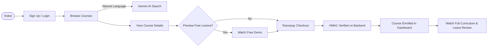
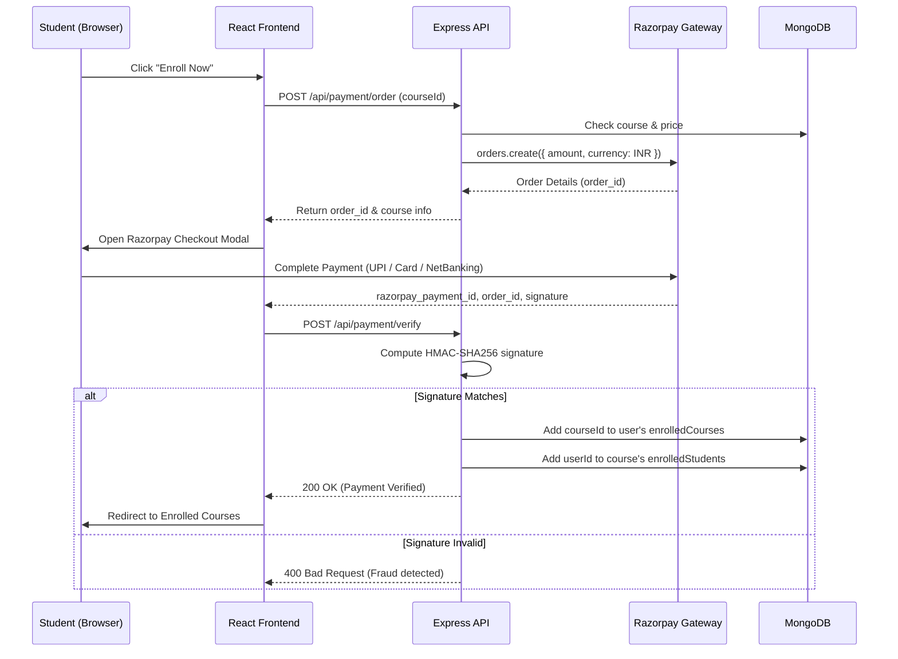

<div align="center">


<a href="https://virtual-classes-6.onrender.com">
  
</a>

<br/><br/>

[](https://virtual-classes-6.onrender.com)
[](https://github.com/abhishek23027kushwaha/virtual-classes)
[](https://opensource.org/licenses/ISC)
[](https://github.com/abhishek23027kushwaha/virtual-classes/commits/main)

<br/>


<br/><br/>

### **🚀 [Try the Live Application](https://virtual-classes-6.onrender.com)**

</div>

<br/>

<div align="center">

### 📊 At a Glance

<table width="100%">
<tr>
<td align="center" width="20%">🌐 <b>Live Platform</b><br/><a href="https://virtual-classes-6.onrender.com"><i>Render</i></a></td>
<td align="center" width="20%">📚 <b>Seeded Courses</b><br/><h3>20+</h3></td>
<td align="center" width="20%">🏷️ <b>Categories</b><br/><h3>9</h3></td>
<td align="center" width="20%">💳 <b>Payments</b><br/><i>Razorpay Gateway</i></td>
<td align="center" width="20%">🤖 <b>AI Integration</b><br/><i>Google Gemini 2.5</i></td>
</tr>
</table>

</div>

---

## 📖 Table of Contents

**🧭 Getting to know it**

&nbsp;&nbsp;📌 [Overview](#-overview) &nbsp;·&nbsp; ✨ [Key Features](#-key-features) &nbsp;·&nbsp; 🏷️ [Course Categories](#️-course-categories) &nbsp;·&nbsp; 🔄 [How It Works](#-how-it-works)

**🛠️ Building it**

&nbsp;&nbsp;🧰 [Tech Stack](#-tech-stack) &nbsp;·&nbsp; 📁 [Project Structure](#-project-structure) &nbsp;·&nbsp; 🚀 [Getting Started](#-getting-started) &nbsp;·&nbsp; 📡 [API Reference](#-api-reference)

**🌍 Beyond the code**

&nbsp;&nbsp;☁️ [Deployment](#️-deployment) &nbsp;·&nbsp; 🛠 [Skills Demonstrated](#-skills-demonstrated) &nbsp;·&nbsp; 🗺️ [Roadmap](#️-roadmap) &nbsp;·&nbsp; 🤝 [Contributing](#-contributing) &nbsp;·&nbsp; 📬 [Contact](#-contact)

---

## 📌 Overview

> **Virtual Classes** is a modern, full-stack **EdTech & Learning Management System (LMS)** designed to bridge the gap between ambitious learners and passionate educators.

Built using the **MERN** stack (MongoDB, Express, React, Node.js), Virtual Classes empowers educators to create, structure, price, and publish multi-lecture video courses, while providing students with an intuitive learning experience complete with **AI-powered search (Gemini 2.5 Flash)**, **Razorpay checkout**, **free video previews**, and **interactive course reviews**.

<div align="right">

[⬆ back to top](#-table-of-contents)

</div>

---

## ✨ Key Features

<table width="100%">
<tr><td>

#### 🔐 Authentication & Role Management 

</td></tr>
<tr><td>✅ &nbsp; <b>JWT-based authentication</b> stored in secure HTTP-only cookies with 7-day expiration</td></tr>
<tr><td>✅ &nbsp; <b>Google OAuth One-Tap sign-in</b> powered by Firebase Client SDK</td></tr>
<tr><td>✅ &nbsp; <b>OTP password reset</b> via Nodemailer email service</td></tr>
<tr><td>✅ &nbsp; <b>Strict Role-Based Access Control</b> (<code>student</code> vs <code>educator</code>) protecting admin creation routes</td></tr>

<tr><td>

#### 🎓 Student Experience & Learning 

</td></tr>
<tr><td>✅ &nbsp; <b>Browse & Category Filtering</b> across 9 technology domains with instant multi-filter state</td></tr>
<tr><td>✅ &nbsp; <b>AI Natural Language Search</b>: Ask questions in plain English (e.g. <i>"how to build neural networks"</i>) and Google Gemini maps intent to matching courses</td></tr>
<tr><td>✅ &nbsp; <b>Free Lecture Previews</b>: Watch introductory video lectures before enrolling</td></tr>
<tr><td>✅ &nbsp; <b>Enrolled Courses Dashboard</b>: Access full video curriculum and course player</td></tr>
<tr><td>✅ &nbsp; <b>Ratings & Reviews</b>: Submit star ratings and feedback for enrolled courses</td></tr>

<tr><td>

#### 👨‍🏫 Educator & Course Management 

</td></tr>
<tr><td>✅ &nbsp; <b>Course Creation Studio</b>: Define title, subtitle, description, category, level, and pricing</td></tr>
<tr><td>✅ &nbsp; <b>Multi-Lecture Management</b>: Add, reorder, edit, and delete video lectures</td></tr>
<tr><td>✅ &nbsp; <b>Cloudinary CDN Uploads</b>: Seamless image thumbnail and lecture video uploads via Multer</td></tr>
<tr><td>✅ &nbsp; <b>Publishing Toggle</b>: Control draft vs. live status of courses</td></tr>
<tr><td>✅ &nbsp; <b>Educator Dashboard</b>: Track created courses and student enrollment counts</td></tr>

<tr><td>

#### 💳 Payments & Security 

</td></tr>
<tr><td>✅ &nbsp; <b>Razorpay Payment Gateway</b>: Automated order creation and client-side modal checkout</td></tr>
<tr><td>✅ &nbsp; <b>Server-side cryptographic verification</b>: HMAC-SHA256 signature verification before granting course access</td></tr>
<tr><td>✅ &nbsp; <b>Automatic Enrollment</b>: Instant enrollment into student's profile upon verified payment</td></tr>
</table>

<div align="right">

[⬆ back to top](#-table-of-contents)

</div>

---

## 🏷️ Course Categories

<div align="center">

**Curated courses across 9 in-demand domains with 20+ pre-seeded masterclasses**

<table width="95%">
<tr>
<td align="center" width="33%">🌐 <b>Web Development</b><br/><sub>MERN, Next.js 15, Modern JS, Microservices</sub></td>
<td align="center" width="33%">🤖 <b>AI / Machine Learning</b><br/><sub>Python ML, Deep Learning, GenAI & LLMs</sub></td>
<td align="center" width="33%">⚡ <b>AI Tools & Automation</b><br/><sub>Prompt Engineering, Midjourney, Make.com</sub></td>
</tr>
<tr>
<td align="center">📱 <b>App Development</b><br/><sub>Flutter & Dart, React Native, Kotlin Android</sub></td>
<td align="center">📊 <b>Data Science</b><br/><sub>Pandas, NumPy, Applied Statistics & Math</sub></td>
<td align="center">📈 <b>Data Analytics</b><br/><sub>Power BI, Tableau, SQL Big Data Querying</sub></td>
</tr>
<tr>
<td align="center">🛡️ <b>Ethical Hacking</b><br/><sub>Kali Linux, Pentesting, Bug Bounty & OWASP</sub></td>
<td align="center">🎨 <b>UI/UX Designing</b><br/><sub>Figma, Design Systems, Prototyping</sub></td>
<td align="center">☁️ <b>DevOps & Cloud</b><br/><sub>Docker, Kubernetes, CI/CD Pipelines, AWS</sub></td>
</tr>
</table>

</div>

<div align="right">

[⬆ back to top](#-table-of-contents)

</div>

---

## 🔄 How It Works

### 👤 Student Learning & Enrollment Journey



### 💳 Razorpay Payment & Server Verification Flow



<div align="right">

[⬆ back to top](#-table-of-contents)

</div>

---

## 🧰 Tech Stack

<div align="center">


</div>

<br/>

<table width="100%">
<tr><th align="left" width="22%">Layer</th><th align="left">Technologies</th></tr>
<tr><td>🎨 <b>Frontend</b></td><td>React 19, Vite, Redux Toolkit, Tailwind CSS, Framer Motion, React Router DOM, React Icons, React Spinners, React Toastify</td></tr>
<tr><td>⚙️ <b>Backend</b></td><td>Node.js, Express.js (ES Modules), JSON Web Token (JWT), bcryptjs, Cookie-Parser, Validator, CORS</td></tr>
<tr><td>🗄️ <b>Database</b></td><td>MongoDB & Mongoose ODM (Atlas Cloud / Local)</td></tr>
<tr><td>🤖 <b>AI & Search</b></td><td>Google GenAI SDK (<code>@google/genai</code>) powered by <b>Gemini 2.5 Flash</b></td></tr>
<tr><td>💳 <b>Payments</b></td><td>Razorpay Payment Gateway API with crypto HMAC verification</td></tr>
<tr><td>☁️ <b>Media & Storage</b></td><td>Cloudinary v2 CDN + Multer DiskStorage with automatic directory setup</td></tr>
<tr><td>📧 <b>Communications</b></td><td>Nodemailer (SMTP) for OTP password resets</td></tr>
<tr><td>🔑 <b>Third-party Auth</b></td><td>Firebase Authentication Client SDK for Google Sign-In</td></tr>
</table>

<div align="right">

[⬆ back to top](#-table-of-contents)

</div>

---

## 📁 Project Structure

```
virtual-classes/
├── backend/
│   ├── config/
│   │   ├── cloudinary.js         # Cloudinary CDN configuration & upload helper
│   │   ├── db.js                 # Resilient MongoDB Mongoose connection
│   │   ├── Mail.js               # Nodemailer transporter & OTP template
│   │   └── token.js              # JWT generation helper
│   ├── controllers/
│   │   ├── auth.controller.js    # Register, login, google auth, OTP reset
│   │   ├── course.controller.js  # Course & lecture CRUD, publishing
│   │   ├── Order.controller.js   # Razorpay order generation & HMAC verification
│   │   ├── review.controller.js  # Star ratings & user reviews
│   │   ├── search.controller.js  # Gemini AI semantic query search
│   │   └── user.controller.js    # Current user data & profile update
│   ├── middlewares/
│   │   ├── isAuth.js             # JWT cookie verification middleware
│   │   └── multer.js             # Disk storage with automatic directory creation
│   ├── models/
│   │   ├── courseModel.js        # Course schema with lectures & reviews refs
│   │   ├── lectureModel.js       # Video URL, title, free preview flag
│   │   ├── reviewModel.js        # Rating (1-5), comment, user ref
│   │   └── userModel.js          # Roles (student/educator), enrolledCourses
│   ├── routers/                  # Express route declarations
│   ├── seedCourses.js            # Automated seed script for 20 masterclasses
│   ├── index.js                  # Express application entry & CORS middleware
│   └── package.json
│
├── frontend/
│   ├── src/
│   │   ├── assets/               # Branding assets & logos
│   │   ├── components/           # Navbar, Footer, CourseCard, ExploreCourses
│   │   ├── customhooks/          # getCurrentUser, useGetCourseData
│   │   ├── pages/                # Home, Allcourses, ViewCourse, ViewLecture,
│   │   │                         # SignUp, Login, ForgotPassword, Profile
│   │   ├── pages/Admin/          # DashBoard, Courses, CreateCourse, AddCourses,
│   │   │                         # CreateLecture, EditLecture
│   │   ├── redux/                # Redux Toolkit store, userSlice, courseSlice
│   │   ├── utils/                # Firebase initialization & auth provider
│   │   ├── App.jsx               # Client routes & serverUrl configuration
│   │   └── main.jsx
│   └── vite.config.js
└── README.md
```

<div align="right">

[⬆ back to top](#-table-of-contents)

</div>

---

## 🚀 Getting Started

### ✅ Prerequisites
* **Node.js 18+** installed on your system
* **MongoDB** (Local instance or free [MongoDB Atlas](https://www.mongodb.com/cloud/atlas) URI)
* Free **Cloudinary** account (for media storage)
* Free **Razorpay** test keys (for checkout testing)
* Free **Google Gemini API Key** (from [Google AI Studio](https://aistudio.google.com/))

---

### 1️⃣ Clone the Repository
```bash
git clone https://github.com/abhishek23027kushwaha/virtual-classes.git
cd virtual-classes
```

---

### 2️⃣ Backend Setup

```bash
cd backend
npm install
```

Create a `.env` file in the `backend/` directory:
```env
PORT=8000
MONGO_URI=your_mongodb_connection_string
JWT_SECRET=your_jwt_secret_key

# Cloudinary CDN credentials
CLOUDINARY_CLOUD_NAME=your_cloud_name
CLOUDINARY_API_KEY=your_cloudinary_api_key
CLOUDINARY_API_SECRET=your_cloudinary_api_secret

# Email service for OTP reset
EMAIL=your_email@gmail.com
EMAIL_PASS=your_email_app_password

# Razorpay credentials
RAZORPAY_KEY_ID=your_razorpay_key_id
RAZORPAY_SECRET=your_razorpay_secret_key

# Google Gemini API
GEMINI_API_KEY=your_gemini_api_key
```

**Seed 20 comprehensive courses, lectures & reviews:**
```bash
npm run seed
```

Start the backend development server:
```bash
npm run dev
```
> The API will be running at `http://localhost:8000`.

---

### 3️⃣ Frontend Setup

In a new terminal window:
```bash
cd frontend
npm install
```

Create a `.env` file in the `frontend/` directory:
```env
VITE_SERVER_URL=http://localhost:8000
```

Start the frontend development server:
```bash
npm run dev
```
> The web application will launch at `http://localhost:5173`.

<div align="right">

[⬆ back to top](#-table-of-contents)

</div>

---

## 📡 API Reference

### 🔐 Authentication (`/api/auth`)

<table width="100%">
<tr><th align="left" width="10%">Method</th><th align="left" width="35%">Endpoint</th><th align="left">Description</th></tr>
<tr><td></td><td><code>/api/auth/signup</code></td><td>Register new student or educator</td></tr>
<tr><td></td><td><code>/api/auth/login</code></td><td>Authenticate user & set HTTP-only cookie</td></tr>
<tr><td></td><td><code>/api/auth/logout</code></td><td>Clear auth cookie</td></tr>
<tr><td></td><td><code>/api/auth/googlesignup</code></td><td>Google OAuth registration/login</td></tr>
<tr><td></td><td><code>/api/auth/sendotp</code></td><td>Send 4-digit password reset OTP to email</td></tr>
<tr><td></td><td><code>/api/auth/verifyotp</code></td><td>Verify submitted OTP</td></tr>
<tr><td></td><td><code>/api/auth/resetpassword</code></td><td>Set new password after OTP verification</td></tr>
</table>

### 📚 Courses & Lectures (`/api/course`)

<table width="100%">
<tr><th align="left" width="10%">Method</th><th align="left" width="35%">Endpoint</th><th align="left">Description</th></tr>
<tr><td></td><td><code>/api/course/getpublishedcourses</code></td><td>Public list of all active courses with lectures & reviews</td></tr>
<tr><td></td><td><code>/api/course/create</code></td><td>Create course draft (Educator only)</td></tr>
<tr><td></td><td><code>/api/course/editcourse/:courseId</code></td><td>Update details, price & upload thumbnail</td></tr>
<tr><td></td><td><code>/api/course/getcourse/:courseId</code></td><td>Get single course details</td></tr>
<tr><td></td><td><code>/api/course/removecourse/:courseId</code></td><td>Delete a course</td></tr>
<tr><td></td><td><code>/api/course/createlecture/:courseId</code></td><td>Add a lecture to a course</td></tr>
<tr><td></td><td><code>/api/course/editlecture/:lectureId</code></td><td>Update lecture title, video URL & preview flag</td></tr>
<tr><td></td><td><code>/api/course/removelecture/:lectureId</code></td><td>Remove lecture from course</td></tr>
<tr><td></td><td><code>/api/course/search</code></td><td>Semantic course search powered by Google Gemini AI</td></tr>
</table>

### 💳 Payments (`/api/payment`)

<table width="100%">
<tr><th align="left" width="10%">Method</th><th align="left" width="35%">Endpoint</th><th align="left">Description</th></tr>
<tr><td></td><td><code>/api/payment/order</code></td><td>Create Razorpay Order instance with course amount</td></tr>
<tr><td></td><td><code>/api/payment/verify</code></td><td>Verify HMAC-SHA256 signature and enroll student</td></tr>
</table>

### ⭐ Reviews & User (`/api/review`, `/api/user`)

<table width="100%">
<tr><th align="left" width="10%">Method</th><th align="left" width="35%">Endpoint</th><th align="left">Description</th></tr>
<tr><td></td><td><code>/api/review/givereview</code></td><td>Submit star rating & text review for a course</td></tr>
<tr><td></td><td><code>/api/review/allReview</code></td><td>Fetch all platform reviews for landing showcase</td></tr>
<tr><td></td><td><code>/api/user/currentuser</code></td><td>Fetch authenticated user profile & enrolled courses</td></tr>
<tr><td></td><td><code>/api/user/updateprofile</code></td><td>Update bio, name & avatar photo</td></tr>
</table>

<div align="right">

[⬆ back to top](#-table-of-contents)

</div>

---

## ☁️ Deployment

<table width="100%">
<tr><th align="left" width="20%">Service</th><th align="left" width="20%">Provider</th><th align="left">Configuration Notes</th></tr>
<tr><td>🌐 <b>Frontend</b></td><td><a href="https://render.com">Render</a> / Netlify / Vercel</td><td>Build: <code>npm run build</code> · Output Dir: <code>dist</code></td></tr>
<tr><td>⚙️ <b>Backend API</b></td><td><a href="https://render.com">Render</a></td><td>Root Dir: <code>backend</code> · Build: <code>npm install</code> · Start: <code>npm start</code></td></tr>
<tr><td>🗄️ <b>Database</b></td><td><a href="https://mongodb.com/atlas">MongoDB Atlas</a></td><td>Free M0 Cluster with multi-region redundancy</td></tr>
<tr><td>☁️ <b>Media CDN</b></td><td><a href="https://cloudinary.com">Cloudinary</a></td><td>Automatic media optimization & secure video streaming</td></tr>
</table>

<div align="right">

[⬆ back to top](#-table-of-contents)

</div>

---

## 🛠 Skills Demonstrated

<table width="100%">
<tr>
<td valign="top" width="33%">

**🎨 Frontend Architecture**
- Component-driven React 19 architecture
- Global state management with Redux Toolkit
- Custom hooks for auth & course syncing
- Fluid UX with Framer Motion & Tailwind CSS

</td>
<td valign="top" width="33%">

**⚙️ Backend & Security**
- Modular RESTful API design with Express.js
- Robust JWT authentication in HTTP-only cookies
- Role-based authorization & route guards
- Cryptographic HMAC verification for payments

</td>
<td valign="top" width="33%">

**🤖 Cloud & AI Integrations**
- Google Gemini 2.5 Flash semantic query mapping
- Razorpay payment gateway integration
- Cloudinary asset upload & optimization pipelines
- Resilient MongoDB schemas & relationships

</td>
</tr>
</table>

<div align="right">

[⬆ back to top](#-table-of-contents)

</div>

---

## 🗺️ Roadmap

<table width="100%">
<tr><th align="left" width="70%">Feature</th><th align="center">Status</th></tr>
<tr><td><b>In-Lecture AI Doubt Assistant</b>: Real-time contextual chat alongside video player</td><td align="center"></td></tr>
<tr><td><b>Course Completion Certificates</b>: Auto-generated verifiable PDF certificates</td><td align="center"></td></tr>
<tr><td><b>Timestamped Video Notes</b>: Save personalized bookmarks directly on video timelines</td><td align="center"></td></tr>
<tr><td><b>Live Learning Streaks & Badges</b>: Gamified student engagement dashboard</td><td align="center"></td></tr>
</table>

<div align="right">

[⬆ back to top](#-table-of-contents)

</div>

---

## 🤝 Contributing

Contributions, feedback, and suggestions are warmly welcome!

<table width="100%">
<tr><th align="center" width="10%">Step</th><th align="left">Action</th></tr>
<tr><td align="center">1️⃣</td><td>Fork the repository</td></tr>
<tr><td align="center">2️⃣</td><td>Create your feature branch — <code>git checkout -b feature/amazing-feature</code></td></tr>
<tr><td align="center">3️⃣</td><td>Commit your changes — <code>git commit -m 'Add some amazing feature'</code></td></tr>
<tr><td align="center">4️⃣</td><td>Push to the branch — <code>git push origin feature/amazing-feature</code></td></tr>
<tr><td align="center">5️⃣</td><td>Open a Pull Request</td></tr>
</table>

<div align="right">

[⬆ back to top](#-table-of-contents)

</div>

---

## 📬 Contact

<div align="center">

**Abhishek Kumar Kushwaha**

[](mailto:abhishek8888raj@gmail.com)
[](https://github.com/abhishek23027kushwaha)
[](https://virtual-classes-6.onrender.com)

### ⭐ If you find this project inspiring, please give it a star on GitHub — it means a lot!


</div>
